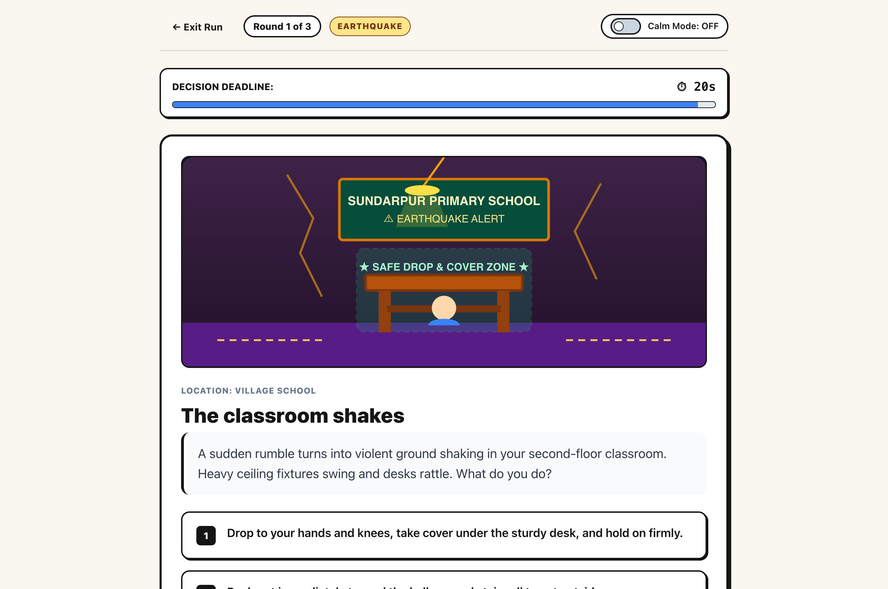
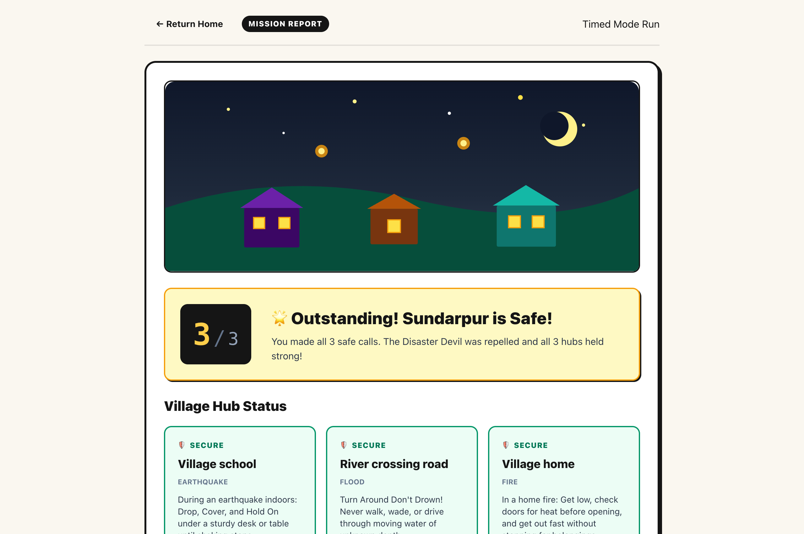

# Disaster Dash ⚡

> **Make the call. Keep your village safe.**  
> An offline, browser-first emergency decision-making game for students and first-time learners facing sudden disaster crises.

[](#)
[](#)
[](#)

---

## 📌 Problem Statement
Students and first-time players practice making quick, safe emergency choices in short disaster scenarios (earthquake, flood, and fire) threatening the fictional village of Sundarpur, learning why safe choices save lives through immediate authoritative feedback.

---

## 🚀 Key Features

1. **Three Fictional Hazard Scenarios:**
   - **Village School Earthquake:** Drop, cover, and hold on under a sturdy desk vs. running through stairwells or standing in doorways (backed by FEMA Ready.gov).
   - **River Crossing Flash Flood:** Turning around toward higher ground vs. wading through 6-inch currents or driving scooters across submerged roadways (backed by CERT & NOAA NWS).
   - **Village Home Fire:** Crawling low beneath the toxic smoke layer and feeling doors before opening vs. searching for valuables or hiding in closets (backed by US Fire Administration).
2. **The Revealed Twist: Calm Mode:**
   - A visible, reversible switch available in Briefing, Question, and Feedback.
   - Instantly hides the countdown timer, cancels pending timeouts, suppresses urgency animations, and presents bite-sized prompts and feedback.
   - Toggling back to Normal mid-question safely grants a fresh full 20-second timer.
3. **Dynamic Feedback & Explanations:**
   - Every answer or timeout reveals why the action was safe or dangerous, accompanied by authoritative guidance citations.
4. **Debrief & Practice Mode:**
   - Location security breakdown (School, River Crossing, Home).
   - Perfect run celebration: Sundarpur village lights up with warm evening lanterns.
   - **Practice Missed Rounds:** Dedicated practice session that queues only missed scenarios without altering the original score.
5. **Accessible & Responsive Design:**
   - Inspired by the OWASP NIE Upcoming Events aesthetic: warm cream `#FAF7F0` canvas, deep dark typography `#151515`, yellow pill CTA `#FFCE4A`, and hazard color tokens.
   - Full keyboard accessibility (`1`, `2`, `3` keys for choices, `Esc` to exit tour), high contrast, and reduced motion support.

---

## 📸 Screenshots

| 1. Main Gameplay Flow (Round 1: School Earthquake) | 2. Mission Debrief & Results (Score 3/3) |
|:---:|:---:|
|  |  |

*Additional screenshots:*
- [Calm Mode Active](docs/screenshots/calm-mode.png)
- [Homepage & Tour](docs/screenshots/home-screen.png)

---

## ⏱️ Quickstart & Run Steps

Zero configuration, zero API keys, zero environment files required.

### 1. Prerequisites
- Node.js (v18 or higher) and npm.

### 2. Install & Run
```bash
# Clone the repository
git clone https://github.com/Shwetankjais/aspire_vibeathon.git
cd aspire_vibeathon

# Install dependencies (only Vite & Puppeteer for tests)
npm install

# Run development server
npm run dev
# -> Opens http://localhost:3000

# Or build and run static production preview
npm run build
npm run preview
# -> Opens http://localhost:4173
```

### 3. Run Automated Tests
```bash
npm test
# Validates scenario schemas, ID uniqueness, and game engine state transitions
```

---

## 🎯 Three-Step Judge Demo (60 Seconds)

1. **Start the Run:** Open the app and click **Play Disaster Dash ➔** on the cream homepage to enter the Sundarpur Mission Briefing. Click **Start Round 1: Village School**.
2. **Test the Twist (Calm Mode):** In Round 1, observe the 20-second countdown bar. Halfway through, click the **Calm Mode switch** in the top right. Notice the timer vanishes, timeout is cancelled, and the prompt simplifies. Select Choice 1: *"Drop to your hands and knees..."* and read the untimed FEMA explanation.
3. **Complete & Review Debrief:** Advance through Round 2 (Flood) and Round 3 (Fire) selecting the safest options. Reach the **Mission Report** to see the 3/3 score, glowing village illustration, three secured location badges, and real-life emergency takeaways.

*(For detailed verification and boundary test cases, see [docs/qa.md](docs/qa.md).)*

---

## 🤖 AI-Use Note

- **AI Tools Used:** Google Antigravity Agent & Gemini 3.8.
- **Specific Fix / Architectural Change Made:** During initial engine integration, toggling Calm Mode back to Normal mid-question initially carried over the remaining fraction of seconds, which could cause immediate accidental timeouts if toggled late. We corrected the state machine so that toggling from Calm back to Normal during an unanswered question grants a fresh full 20-second timer (`ROUND_DURATION_MS`), ensuring fair and predictable player experience.

---

## ⚠️ Known Limitations & Out of Scope
- **Audio Effects:** Audio clips are intentionally omitted in favor of visual alerts to keep the package lightweight, dependency-free, and suitable for quiet classroom environments.
- **Multiplayer / Leaderboards:** Gameplay is purely local in-browser and does not communicate with external servers or cloud databases, in compliance with event privacy requirements.
- **Live Advice Disclaimer:** Disaster Dash is an educational simulation designed for classroom learning, not live emergency dispatch or real-time navigation.
